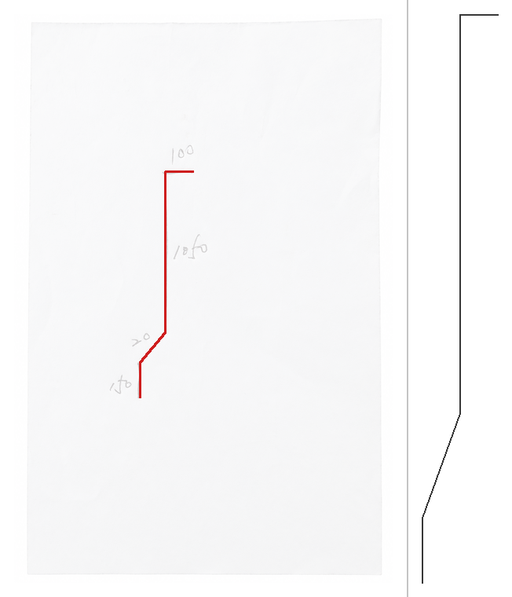
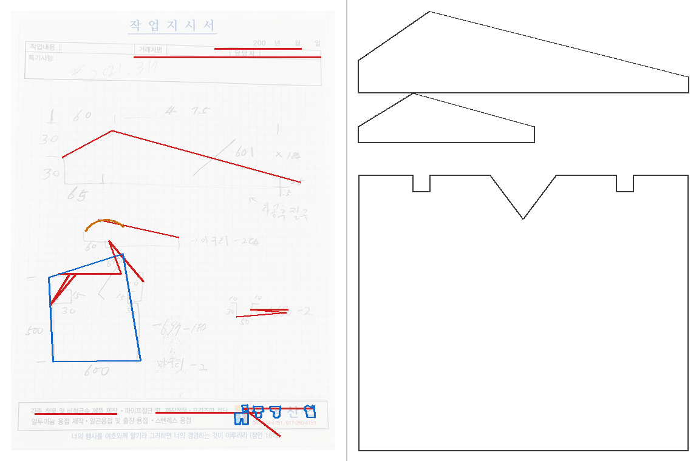
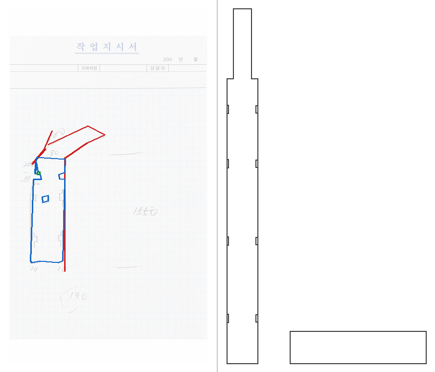
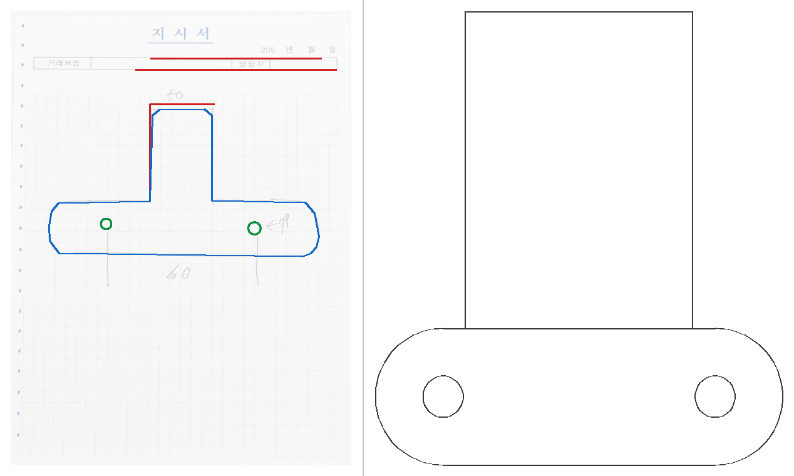
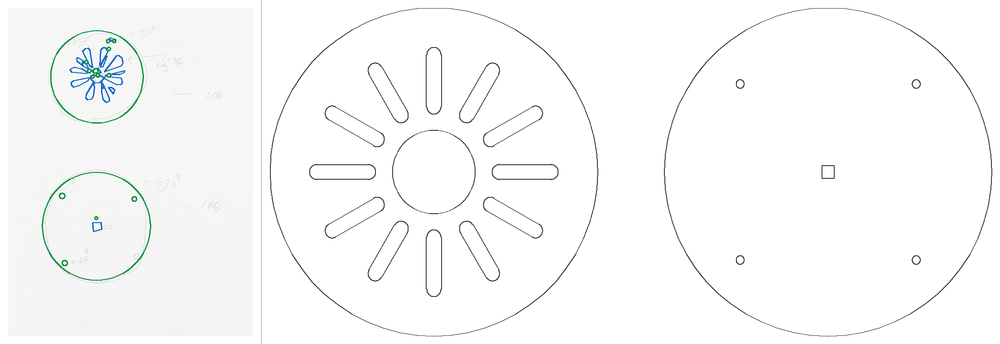
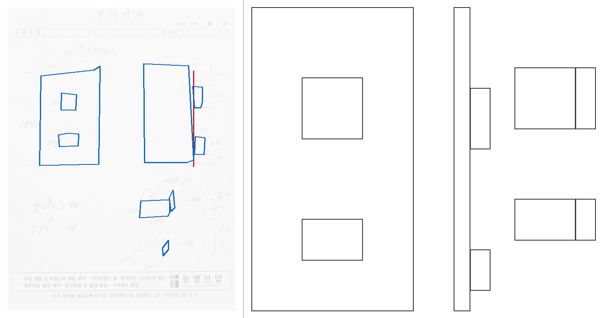
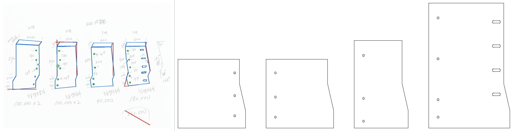

# 샘플 추출 결과

`scripts/render_sample_report.py`가 생성합니다. 각 이미지는 왼쪽이
파이프라인이 추출한 geometry를 원본 사진 위에 겹친 것이고, 오른쪽이
같은 스케치의 레퍼런스 DXF입니다. 레퍼런스는 다중 뷰 재배치와 해석된
치수를 포함한 완성형 해석본이므로 구조를 비교하는 용도이며 픽셀 단위
정답지가 아닙니다.

선 색: 빨강 `LINE`, 파랑 `LWPOLYLINE`, 초록 `CIRCLE`, 주황 `ARC`.

```powershell
uv run python scripts/render_sample_report.py
```

## 요약

OCR 제안은 로컬 PP-OCR이 읽고 가까운 geometry 하나에 미리 연결한
검토 전 값이며, 확정된 치수가 아닙니다.

| 샘플 | 선택 variant | 상태 | 추출 | OCR 제안 | 레퍼런스 |
| --- | --- | --- | --- | --- | --- |
| 1 | `blur_otsu` | `READY` | line 4 | 3 | LWPOLYLINE 1 |
| 2 | `blur_otsu` | `READY` | circle 2, line 2, polyline 5 | 8 | LWPOLYLINE 3 |
| 3 | `blur_otsu` | `READY` | circle 1, line 8, polyline 3 | 1 | LWPOLYLINE 10 |
| 4 | `clahe_adaptive` | `READY` | circle 2, line 2, polyline 1 | 1 | ARC 2, CIRCLE 2, LINE 2, LWPOLYLINE 1 |
| 5 | `shadow_removed_adaptive` | `READY` | circle 15, polyline 18 | 0 | ARC 24, CIRCLE 7, LINE 24, LWPOLYLINE 1 |
| 6 | `clahe_adaptive` | `READY` | line 1, polyline 9 | 6 | LWPOLYLINE 10 |
| 7 | `shadow_removed_adaptive` | `READY` | circle 18, line 9, polyline 17 | 26 | ARC 8, CIRCLE 13, LINE 8, LWPOLYLINE 4 |

## 샘플 1



- 선택 variant: `blur_otsu`
- 상태: `READY`
- 추출: line 4
- OCR 제안: `1050`, `20`, `50`
- 레퍼런스: LWPOLYLINE 1
- 경고: `PERSPECTIVE_REJECTED`, `TEXT_STROKES_REMOVED`

## 샘플 2



- 선택 variant: `blur_otsu`
- 상태: `READY`
- 추출: circle 2, line 2, polyline 5
- OCR 제안: `160`, `475`, `30`, `601`, `30`, `25`, `65`, `21`
- 레퍼런스: LWPOLYLINE 3
- 경고: `PERSPECTIVE_NOT_FOUND`, `DOCUMENT_NOT_FOUND`, `TEXT_STROKES_REMOVED`

## 샘플 3



- 선택 variant: `blur_otsu`
- 상태: `READY`
- 추출: circle 1, line 8, polyline 3
- OCR 제안: `140`
- 레퍼런스: LWPOLYLINE 10
- 경고: `PERSPECTIVE_NOT_FOUND`, `DOCUMENT_NOT_FOUND`, `TEXT_STROKES_REMOVED`

## 샘플 4



- 선택 variant: `clahe_adaptive`
- 상태: `READY`
- 추출: circle 2, line 2, polyline 1
- OCR 제안: `50`
- 레퍼런스: ARC 2, CIRCLE 2, LINE 2, LWPOLYLINE 1
- 경고: `PRINTED_RULING_REMOVED`, `PERSPECTIVE_NOT_FOUND`, `DOCUMENT_NOT_FOUND`, `TEXT_STROKES_REMOVED`

## 샘플 5



- 선택 variant: `shadow_removed_adaptive`
- 상태: `READY`
- 추출: circle 15, polyline 18
- OCR 제안: 없음
- 레퍼런스: ARC 24, CIRCLE 7, LINE 24, LWPOLYLINE 1
- 경고: `PERSPECTIVE_NOT_FOUND`, `DOCUMENT_NOT_FOUND`, `TEXT_STROKES_REMOVED`

## 샘플 6



- 선택 variant: `clahe_adaptive`
- 상태: `READY`
- 추출: line 1, polyline 9
- OCR 제안: `400`, `100`, `300`, `100`, `200`, `100`
- 레퍼런스: LWPOLYLINE 10
- 경고: `PERSPECTIVE_NOT_FOUND`, `DOCUMENT_NOT_FOUND`, `TEXT_STROKES_REMOVED`

## 샘플 7



- 선택 variant: `shadow_removed_adaptive`
- 상태: `READY`
- 추출: circle 18, line 9, polyline 17
- OCR 제안: `500`, `400`, `600`, `20`, `180`, `0149`, `150`, `510`, `70`, `180`, `650`, `320`, `930`, `176`, `151`, `60`, `200`, `200`, `200`, `0149`, `200`, `130`, `170`, `130`, `130`, `12`
- 레퍼런스: ARC 8, CIRCLE 13, LINE 8, LWPOLYLINE 4
- 경고: `PERSPECTIVE_NOT_FOUND`, `DOCUMENT_NOT_FOUND`, `TEXT_STROKES_REMOVED`
